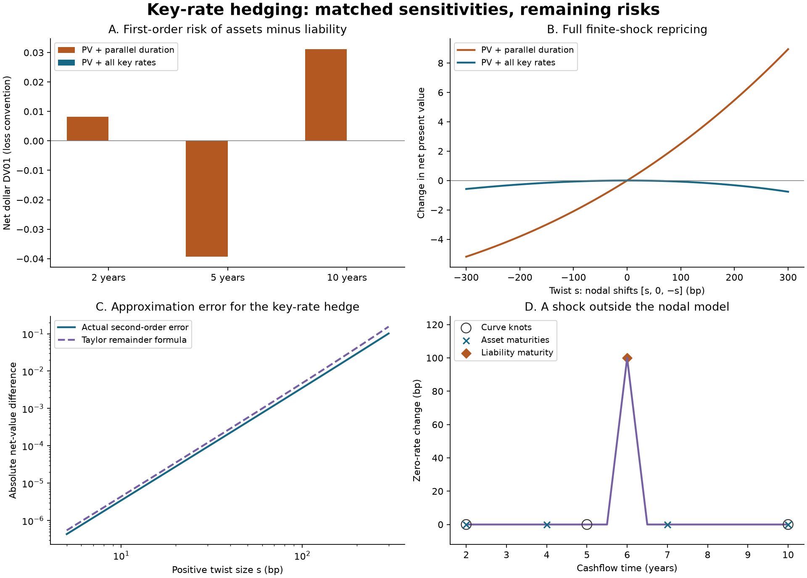

# Cashflow key-rate hedging

Compare a parallel-duration hedge with a hedge that matches every quoted zero-rate sensitivity, then audit what remains unhedged. This small project uses analytic derivatives, a numerically diagnosed linear hedge solve, full finite-shock repricing, and an independent 60-digit Decimal reference.

**Educational only. Not investment advice.** Every cashflow, instrument, rate, and shock is deterministic and synthetic. There are no market observations, backtest returns, or claims of investment performance.

## Reproduce

Python 3.11 or 3.13:

```bash
python3 -m venv .venv
source .venv/bin/activate
python -m pip install -r requirements-repro.txt
python -m pip install --no-deps .
python -m pip check
python -m pytest -q
python examples/run_demo.py --output results
cashflow-risk examples/liability.json
```

The core needs NumPy; the demonstration also needs Matplotlib. Tests use pytest. Exact environment pins are in `requirements-repro.txt`; package-level compatible dependencies are in `pyproject.toml`. The workflow installs the package and runs the tests, example, and CLI on both Python versions. JSON outputs contain actual computed results. They are deterministic on the same numerical stack; last bits and image metadata can vary across platforms.

## Model and units

Cashflow time is measured in years, cashflow amounts in an arbitrary currency unit, and rates are annual, continuously compounded **zero rates** in decimal units. One basis point is 0.0001. Knots must bracket every cashflow: extrapolation is rejected. Between knots, the zero rate is piecewise linear:

$$z(t)=\sum_j B_j(t)r_j,\qquad V(r)=\sum_i c_i\exp[-t_i z(t_i)].$$

The triangular basis functions are nonnegative and sum to one. With $p_i=c_i\exp[-t_i z(t_i)]$, the implemented derivatives are

$$g_j=-\sum_i p_i t_i B_j(t_i),\qquad H_{jk}=\sum_i p_i t_i^2 B_j(t_i)B_k(t_i).$$

`dollar_dv01[j] = -0.0001 * g[j]` uses the positive-loss convention for a rate rise; the approximate signed value change is its negative times the number of basis points. Parallel dollar duration is $-\sum_j g_j$, and parallel dollar convexity is $\sum_{jk}H_{jk}$. These are **dollar sensitivities**, not duration or convexity divided by price. This avoids dividing a nearly zero net surplus by its present value. Signed cashflows are supported; their Hessian need not be positive semidefinite.

For a finite zero-rate change $h_i$ at each cashflow time, full repricing uses

$$\Delta V=\sum_i p_i\operatorname{expm1}(-t_i h_i).$$

Using `expm1` retains small changes that would be lost by subtracting two nearly equal prices. For nodal shocks $h=B\Delta r$, the second-order approximation is $g^T\Delta r+\tfrac12\Delta r^T H\Delta r$. The real-arithmetic Taylor remainder satisfies

$$|R_3|\leq\sum_i |p_i|\exp(|t_i h_i|)|t_i h_i|^3/6.$$

The reported formula is evaluated in float64; it is **not a directed-rounding certificate** and does not include floating-point error. For a signed portfolio it can be conservative because it sums absolute cashflow contributions. The reference module separately interpolates and discounts in 60-digit Decimal arithmetic, interpreting the supplied floating-point numbers exactly. It is a numerical cross-check, not an interval proof.

## Hedge construction

For each instrument with positive price $P_a$, the unknown $w_a$ is its signed present-value allocation divided by liability present value $L$. Holdings are $q_a=w_a L/P_a$. The two solves are:

- **Parallel:** match present value and parallel dollar duration, using zero coupons at 2 and 10 years.
- **Key-rate:** match present value and all three nodal dollar sensitivities, using zero coupons at 2, 4, 7, and 10 years.

Both solve a linear system in PV allocations. Sensitivities are divided by price and the last knot's time to put constraint rows on comparable scales. `numpy.linalg.lstsq(rcond=1e-12)` returns the minimum Euclidean-norm PV allocation in an underdetermined system, or a least-squares candidate if infeasible. This is invariant to changing instrument face-value units. It does **not** minimize gross exposure or impose long-only constraints.

The report includes singular values, numerical rank, and every scaled residual. `matched` means the maximum absolute scaled residual is at most 1e-10. `outside_instrument_span` means the candidate does not meet this numerical threshold and must not be called a hedge satisfying the constraints. A small residual alone is not a conditioning or robustness guarantee. Shorts are allowed; gross and short PV multiples are always reported. No financing or borrowing costs are modeled.

## Synthetic experiment

The curve has knots `[2, 5, 10]` years and continuous zero rates `[0.025, 0.032, 0.038]`. The liability pays 100 at year 6. Hedge instruments pay one currency unit at their stated maturities. There is no simulated sampling noise and no fitted historical curve.

The parallel hedge's PV allocations are exactly `[1/2, 1/2]` in real arithmetic. The four-instrument key-rate hedge has PV allocations `[4/13, -6/13, 56/39, -11/39]`. Its gross PV multiple is `97/39`, and its short PV multiple is `29/39`. Matching more risk directions therefore requires substantial offsetting positions in this example.

The run in this repository values the liability at **81.9385999744**. Observed results, rounded for display:

| Quantity | PV + parallel duration | PV + all key rates |
|:--|--:|--:|
| Gross PV / liability PV | 1.000000 | 2.487179 |
| Short PV / liability PV | 0.000000 | 0.743590 |
| Net-value change: parallel +100 bp | +0.061742 | +0.000420 |
| Net-value change: twist `[+100, 0, -100]` bp | +2.508346 | -0.077211 |
| Net-value change: reverse twist `[-100, 0, +100]` bp | -2.093722 | -0.070280 |
| Net-value change: belly `[0, +100, 0]` bp | +3.840152 | -0.003894 |
| Net-value change: off-grid +100 bp bump | +4.771733 | +4.771733 |
| Net-value change: off-grid -100 bp bump | -5.066800 | -5.066800 |

These are fixed-holdings scenario changes in currency units. The larger positive twist result of the parallel hedge is an unmatched exposure, not evidence of a superior strategy. Across the twelve nodal scenario calculations, the maximum difference from the independent Decimal change was about **2.14e-15** currency units on the local run. That measured agreement is specific to these examples and is not a universal accuracy bound.



`results/summary.json` contains hedge diagnostics, six nodal shock scenarios, the off-grid experiment, and Decimal comparisons. `results/twist_sweep.json` contains the full repricing, Taylor terms, and remainder formulas across twists from -300 to +300 basis points. Net value means **assets minus liability**, and changes hold the hedge quantities fixed. All shocks are instantaneous: no passage of time or rebalancing is modeled.

### An interpolation-specific identity

Because linear basis functions reproduce time, $\sum_j k_j B_j(t)=t$ for knot times $k_j$. Therefore

$$-\sum_j k_j g_j=\sum_i p_i t_i^2=\sum_{jk}H_{jk}.$$

Matching all nodal gradients under this particular model also matches parallel dollar convexity. That explains why this example can have especially small residuals under parallel shifts. It does **not** mean arbitrary curve-shock Hessians are matched, that all finite shifts are hedged, or that the identity holds for a different interpolation/risk convention. A test checks the identity independently on signed cashflows.

### What the knots cannot see

The separate triangular perturbation

$$h(t)=100\max(0,1-|t-6|/0.5)\quad\text{basis points}$$

is zero at all three curve knots and all hedge-asset maturities, but equals 100 bp at the liability maturity. It is **outside** the three-knot piecewise-linear curve family. Both hedges' assets are unchanged while the liability value moves. The example also evaluates the negative perturbation. This is an explicit model-scope counterexample, not a claim that these are calibrated or likely yield-curve moves. In particular, no arbitrage-free forward-curve restriction is imposed.

## API and input safety

```python
from cashflow_hedge import Cashflows, ZeroCurve, risk, stress, match_risk, net_cashflows

curve = ZeroCurve([2, 5, 10], [.025, .032, .038])
liability = Cashflows([6], [100])
assets = [Cashflows([t], [1]) for t in [2, 4, 7, 10]]
hedge = match_risk(assets, liability, curve, mode="keyrate")
if hedge["status"] == "matched":
    net = net_cashflows(assets, hedge["holdings"], liability)
    print(stress(net, curve, knot_shifts_bp=[100, 0, -100]))
```

The CLI prices and optionally stresses cashflows; hedge construction is exposed in the Python API. JSON accepts `curve`, `cashflows`, and at most one of `knot_shifts_bp` or `cashflow_shifts_bp`; see `examples/liability.json`. It rejects duplicate/unknown keys, null shock vectors, booleans in numeric vectors, nonfinite numbers, and inputs over 1 MiB. It reads without modifying the input. Exit status is 0 for success, 1 for invalid data/file/numerical errors, and 2 for command-line usage errors.

Limits keep the implementation small: 2–12 knots, 1–500 cashflows per valuation, 1–20 hedge instruments, positive times at most 50 years, absolute cashflows at most 1e9, absolute base zero rates at most 20%, and absolute shocks at most 2000 bp. Rates after shocks can lie outside the base-rate range. These are computational input limits, not economic constraints. Aggregated net portfolios must also fit the cashflow limits. Decimal reference inputs are assumed already validated.

## Verification and limitations

The 60 tests cover independent Decimal prices and finite-shock changes, closed-form zero-coupon sensitivities, finite-difference gradients/Hessians, basis identities, Taylor behavior, exact rational hedge allocations, face-value rescaling, rank deficiency, infeasible spans, off-grid exposures, tiny shocks, and strict CLI errors.

This is a fixed-cashflow sensitivity exercise. It omits coupon schedules, day-count conventions, accrued interest, settlement, instrument quote bootstrapping, credit/liquidity spreads, embedded options, changing cashflows, covariance estimation, transaction costs, collateral, margin, funding, short-sale availability, and portfolio constraints. It does not measure hedge quality against real data or compare economic risk-adjusted performance. Finite-shock differences are scenario valuation changes, not earned returns or forecasts. Adding more knots can expose additional directions but does not remove model risk.

## References and provenance

The code, synthetic example, tests, and figure are written for this repository. No external dataset or private research material is used.

- [MathWorks: key-rate duration](https://www.mathworks.com/help/finance/bndkrdur.html) describes sensitivity to nonparallel zero-curve shifts. This project uses the stated analytic continuously compounded, linear-zero-rate convention rather than claiming equivalence to a library's bond conventions.
- [Federal Reserve: The U.S. Treasury Yield Curve: 1961 to the Present](https://www.federalreserve.gov/Pubs/feds/2006/200628/index.html) provides background on discount functions, yield curves, and interest-rate sensitivities. Its data and fitted curve are not used here.

MIT licensed. See `LICENSE`.
